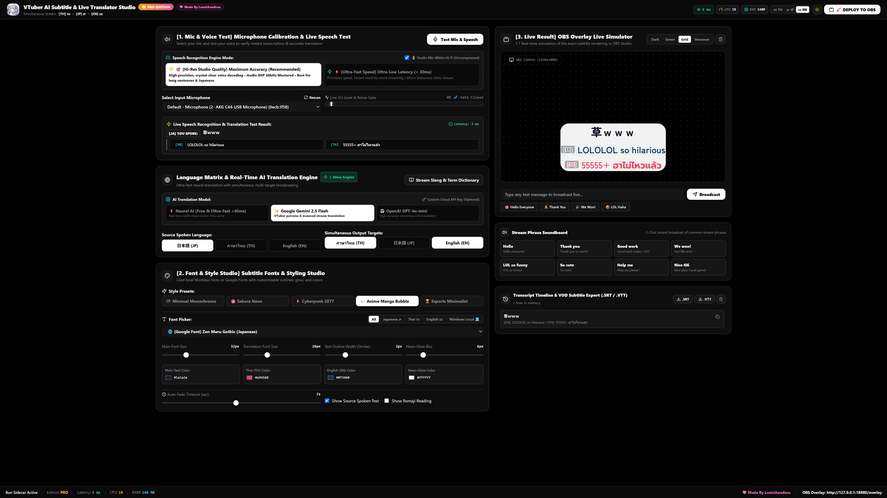

# VTuber Subtitle Studio: live subtitles and translation for OBS

<p align="center">
  
</p>

VTuber Subtitle Studio turns your microphone into live subtitles on stream. It listens to what you say, writes it out, translates it, and shows both lines in OBS Studio through a transparent browser source. It was made for VTubers and streamers who talk in Thai, Japanese or English and want viewers in the other languages to follow along.

It runs on your own Windows PC and only listens on `127.0.0.1`, so nothing is exposed to your network.

## What it does

- Speech to text from your microphone, in Thai, Japanese or English.
- Live translation between those three languages.
- An OBS overlay at `/overlay` with a transparent background and no watermark.
- Subtitle styling: font, size, colour, outline and glow, with a live preview before you go on air.
- The app itself can be switched between Thai, Japanese and English.

## Free and Pro editions

This repository is the free Community Edition under the MIT licence.

The [Pro edition on Gumroad](https://lumichandesu.gumroad.com/l/VTuber-Subtitle-Studio) adds:

- translation into two languages at once (for example Thai to Japanese and English),
- your own Gemini or OpenAI key for higher-quality translation,
- export of the whole stream as `.srt` or `.vtt` subtitles for VODs and clips,
- a glossary for names and slang that should not be translated,
- hotkeys for phrases you use often,
- a Windows `.exe` that runs without installing anything.

## Run it from source

You need [Bun](https://bun.sh) 1.1 or newer on Windows 10 or 11.

```bash
git clone https://github.com/Lumichandesu/vtuber-subtitle-studio.git
cd vtuber-subtitle-studio
bun install
bun run dev
```

Open `http://127.0.0.1:18890` for the studio. In OBS, add a Browser Source pointing to `http://127.0.0.1:18890/overlay`. If port 18890 is taken, the app picks the next free port and prints it in the console.

Speech recognition uses the browser's built-in Web Speech API, so open the studio in Chrome or Edge.

## Built with

Bun, Elysia, React 19, Vite and Tailwind CSS.

## Licence

MIT. See [LICENSE](LICENSE).
